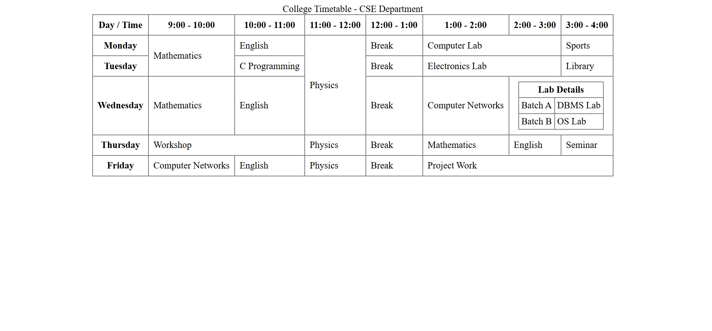

# Experiment 3 – College Timetable

A college timetable webpage built with HTML tables.

## Objectives
- Design a college timetable webpage using HTML tables
- Apply `rowspan` and `colspan` attributes for merging cells
- Use table headers (`<th>`), captions (`<caption>`) and formatting for readability
- Implement a nested table inside a timetable cell

## Features
- Table caption: *College Timetable - CSE Department*
- Header row with time slots and header cells for each day
- Merged cells using `rowspan` (Mathematics, Physics) and `colspan` (Computer Lab, Electronics Lab, Workshop, Project Work)
- Nested **Lab Details** table (Batch A – DBMS Lab, Batch B – OS Lab) inside Wednesday's slot

## How to Run
1. Download or clone this repository
2. Open `index.html` in any web browser (or use the Live Server extension in VS Code)

## Output

## Outcome
- Successfully created a college timetable webpage using HTML tables
- Implemented rowspan, colspan, headers, captions, and nested tables
- Learned to organize tabular data in a structured webpage format
